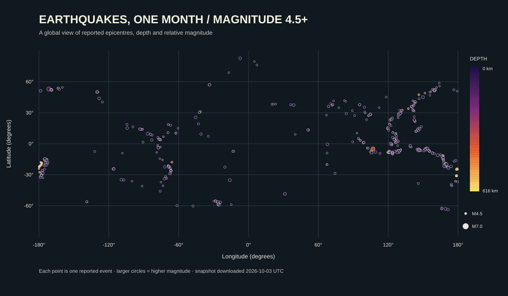

# Earthquakes, one month

This project visualises earthquakes of magnitude 4.5 and above reported by the United States Geological Survey (USGS) during the month-long period represented by its feed. I chose earthquakes because their locations, magnitudes and depths make it possible to compare several dimensions of one natural phenomenon in a single picture. The data snapshot in this repository was downloaded on 3 October 2026 (UTC), so the image can be regenerated without an internet connection.

The source is the [USGS Magnitude 4.5+ Earthquakes, Past Month GeoJSON feed](https://earthquake.usgs.gov/earthquakes/feed/v1.0/summary/4.5_month.geojson). The committed file contains 513 event features. Each feature represents one reported earthquake and includes a longitude and latitude in degrees, a magnitude (a dimensionless measure), and a hypocenter depth in kilometres. The feed changes over time; the committed file is the unchanged snapshot used for this image.



Each dot marks an earthquake's reported epicentre: bigger circles indicate larger magnitudes, and colour indicates depth below the surface. The clusters show where these reported events occurred during the snapshot period. This flat longitude-and-latitude view has no coastlines or tectonic plate boundaries, does not show the order of events in time, and distorts geographic distances near the poles; it also includes only events in this feed, not smaller earthquakes.

To regenerate the picture from the committed data file, run:

```text
uv run plot.py
```
